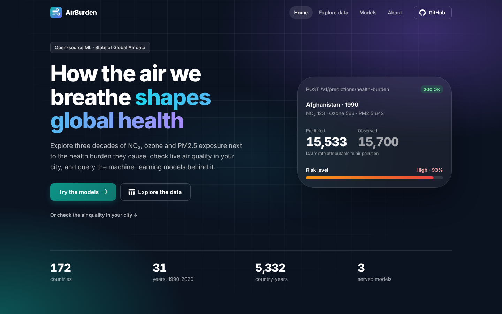
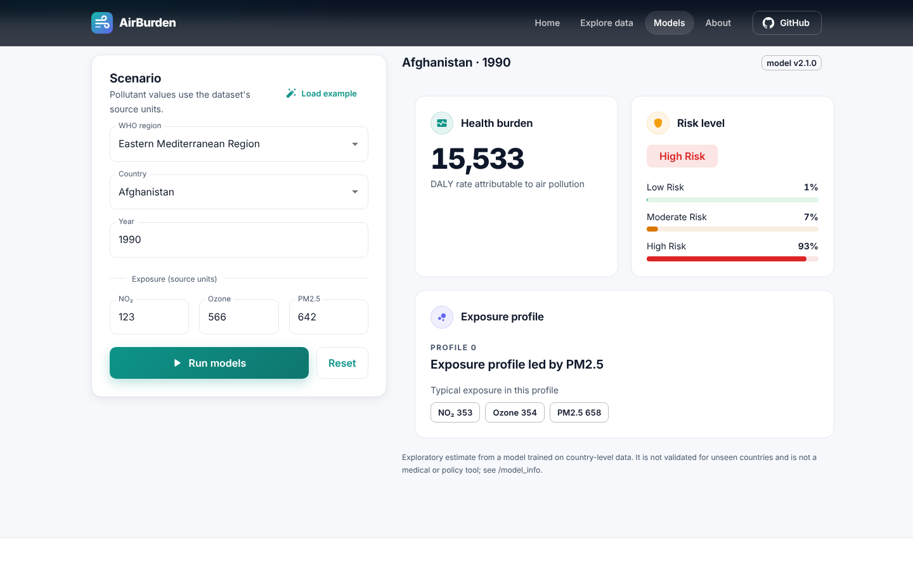
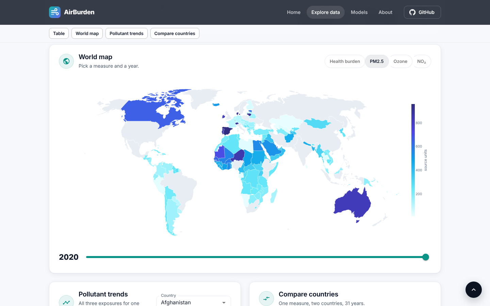
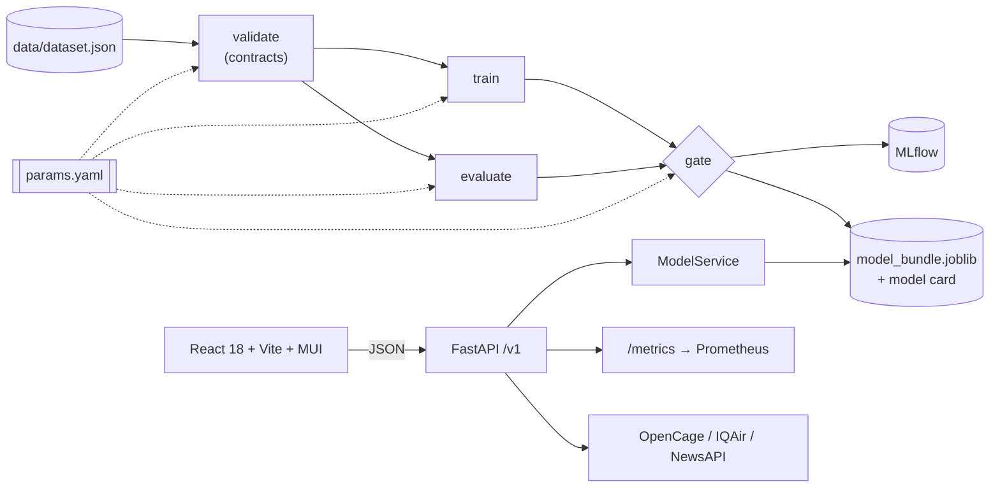

# AirBurden

**An end-to-end ML system with production MLOps: data contracts, a reproducible DVC pipeline, MLflow experiment tracking, release gates, a monitored model-serving API and an interactive dashboard.**

[](https://github.com/prattaybanik03/airburden/actions/workflows/ci.yml)
[](https://github.com/prattaybanik03/airburden/actions/workflows/security.yml)
        

AirBurden estimates how air-pollution exposure (NO2, ozone, PM2.5) relates to health burden across 172 countries (1990-2020). It covers the full ML lifecycle in one repository: validated data, reproducible training, honest evaluation, gated releases, a versioned and observable REST API, a React dashboard, containerisation, 76 automated tests and CI.

**Live demo:** [airburden.onrender.com](https://airburden.onrender.com) (API docs: [airburden-api.onrender.com/docs](https://airburden-api.onrender.com/docs)). Hosted on free instances, so the first request after a pause can take about a minute.



| Model workbench | Data explorer |
|---|---|
|  |  |

## The pipeline

One command (`python -m ml.pipeline run`, or `dvc repro`) takes the raw extract to a released model. Every number comes from
[`params.yaml`](backend/params.yaml), and any failing stage stops the run, the CI job and the Docker build.

| Stage | What it does | Where |
|---|---|---|
| 1. Validate | Pins the dataset SHA-256, enforces **pandera data contracts** (types, ranges, regions, uniqueness, balanced panel) and a data-quality threshold, writes a validated parquet table and a lineage report | `ml/contracts.py`, `ml/pipeline.py` |
| 2. Train | Seeded Random Forest regressor + classifier and K-Means profiles. Records params, data hashes, library versions, a **prediction fingerprint** for reproducibility, feature ranges and a drift reference profile | `ml/train.py` |
| 3. Evaluate | Random vs held-out-country vs temporal splits, with trivial baselines | `ml/evaluate.py`, [docs](docs/evaluation.md) |
| 4. Gate | **Release criteria** on the honest splits, a generated **model card**, one **MLflow** run (params, metrics, tags, artifacts) | `ml/gates.py`, `ml/tracking.py`, [model card](docs/model-card.md) |
| Serve | FastAPI `/v1` (single + batch), extrapolation warnings, `/health` + `/ready`, **Prometheus** `/metrics`, JSON logs with request IDs | `backend/app/` |
| Monitor | Per-feature PSI drift check against the training distribution | `ml/drift.py` |
| Deliver | Layered lockfiles, multi-stage Docker image built *through* the gated pipeline, pytest (76 tests, 94% coverage), GitHub Actions (lint, tests, coverage gate, `dvc repro`, image smoke test) | `backend/Dockerfile`, `.github/workflows/` |

The design and the reasons behind each piece are in **[docs/mlops.md](docs/mlops.md)**. The first tracked experiment
(does repairing corrupted pollutant values help?) is in [docs/experiments.md](docs/experiments.md).

## Features

* **Health-burden regression** (Random Forest): estimated DALY rate for a country, year and exposure levels.
* **Risk classification** (Random Forest): Low / Moderate / High risk with class probabilities.
* **Exposure profiles** (K-Means, k = 3): which pollutant profile a set of exposures resembles.
* **Live air quality** by city (OpenCage geocoding + IQAir) with US EPA AQI bands, and **health news** (NewsAPI).
* **Dataset explorer** with filtering, charts and CSV export.
* Versioned, Pydantic-validated API with batch predictions, readiness and Prometheus metrics; configurable CORS, Docker Compose deployment, GitHub Actions CI.

## Architecture



More detail in [docs/architecture.md](docs/architecture.md).

## Quick start

**With Docker** (builds the model into the image):

```bash
docker compose up --build     # API: http://localhost:8000/docs   UI: http://localhost:8080
```

**Deploy**: [`render.yaml`](render.yaml) is a one-click Blueprint for free hosting ([docs/deployment.md](docs/deployment.md)). The API also runs on
Google Cloud Run ([guide](docs/deploy-gcp.md)), and [docs/aws-architecture.md](docs/aws-architecture.md) is a production AWS design
(ECS Fargate, CloudFront + WAF, OIDC CI/CD, blue/green, cost model and ADRs).

**Local development**:

Requirements: Python 3.12, Node 20+.

```bash
# 1. backend
cd backend
python -m venv .venv && source .venv/bin/activate
pip install -r requirements-dev.lock
cp .env.example .env            # optional: add API keys for the live air-quality and news panels
python -m ml.pipeline run       # validate -> train -> evaluate -> gate (~30 s), logged to MLflow
LOG_FORMAT=text python -m uvicorn app.main:app --reload     # http://127.0.0.1:8000/docs

# 2. frontend (new terminal)
cd frontend
npm install
npm run dev                     # http://localhost:5175
```

The model endpoints work without any API keys. Only `/air_quality` and `/health_news` need them (they return 503 if a key is missing).

Example request:

```bash
curl -X POST http://127.0.0.1:8000/v1/predictions/health-burden -H 'Content-Type: application/json' -d '{
  "year": 1990, "exposure_mean_no2": 123, "exposure_mean_ozone": 566, "exposure_mean_pm25": 642,
  "country": "Afghanistan", "region_name": "Eastern Mediterranean Region"}'
```

## API

Interactive docs at `/docs` (OpenAPI). The model endpoints need no API keys.

| Method and path | Purpose |
|---|---|
| `POST /v1/predictions/health-burden` | Estimated DALY rate, with `model_version` and out-of-range `warnings` |
| `POST /v1/predictions/risk-level` | Low / Moderate / High risk with class probabilities |
| `POST /v1/predictions/batch` | Burden and risk for up to 500 rows in one call |
| `POST /v1/clusters/assign` | Nearest exposure profile |
| `GET /v1/model` | Model metadata, data lineage, feature ranges, thresholds, clusters |
| `GET /health`, `GET /ready` | Liveness, and readiness (503 until a compatible model is loaded) |
| `GET /metrics` | Prometheus metrics |
| `GET /air_quality`, `GET /health_news` | Live data (need API keys in `.env`) |

The unversioned routes the dashboard uses (`/predict_health_burden`, …) are still served but are deprecated in favour of `/v1`.
Every response carries `X-Request-ID` and `X-Model-Version` headers.

Common commands: `make pipeline`, `make repro` (DVC), `make test`, `make cov`, `make lint`, `make mlflow` (tracking UI), `make drift FILE=…`.
Run `make help` for the full list.

## Evaluation at a glance

| Features | Random split R² | Held-out countries R² | Temporal split R² |
|---|---|---|---|
| App features (year, country id, region id, 3 pollutants) | 0.92 | 0.31 | 0.74 |
| Pollutants only | 0.65 | 0.14 | 0.02 |
| *Baseline: last value carried forward* | n/a | n/a | **0.94** |

Reproduce with `make evaluate`.

## Repository layout

```
backend/    FastAPI app (app/), pipeline code (ml/), params.yaml, dvc.yaml, tests (tests/)
frontend/   React single-page app
data/       State of Global Air extract + data card
docs/       MLOps design, architecture, AWS and GCP deployment, evaluation, experiments, model card, data quality, v1-vs-v2
.github/    CI and security workflows, Dependabot, branch and tag rulesets, CODEOWNERS
```

## Revisiting my 2024 version

AirBurden began as a 2024 university project. In 2026 I went back, tested it properly, and rebuilt it. Along the way I found bugs in my original serving code
and an over-optimistic evaluation, and fixed them. The details are in [docs/v1-vs-v2.md](docs/v1-vs-v2.md); the headline:

| | 2024 version (v1) | This version |
|---|---|---|
| Afghanistan 1990, observed health burden **15,700** | service returned **1,053** | **15,533** |
| Why | model inputs were assembled in a different column order from training, and the output was un-scaled with the wrong scaler column | one shared feature list for training and serving, no scaler to invert, regression test |
| Reported performance | R² ≈ 0.92 on a random split | R² 0.92 random, **0.31 on unseen countries**; does not beat a region average or "last value carried forward" |
| Data | taken at face value | ~7-8% of each pollutant column is corrupted in the source extract ([details](docs/data-quality.md)) |
| Tests | none | 76 backend tests (94% coverage) + CI |

The full evaluation, with baselines, is in [docs/evaluation.md](docs/evaluation.md). In short: a random split on panel data lets the model recognise
*which country it is looking at*. On countries it has never seen, pollutant exposure adds little. I'd rather show that than hide it.

## Limitations and roadmap

* This is an **exploratory** model on ecological, country-level data. It is not a validated health tool and the API says so in every response.
* Re-source the dataset from the publisher and fix the corrupted pollutant values ([docs/data-quality.md](docs/data-quality.md)). An opt-in interpolation repair exists; [EXP-001](docs/experiments.md) shows it does not close the unseen-country gap.
* Add a DVC remote and an MLflow server so caches and runs are shared, and schedule `ml.drift` over logged requests.
* Try within-country (panel / fixed-effects) modelling and add covariates such as income and age structure.
* Frontend: add a dark mode and browser end-to-end tests in CI.

## Security

`main` only changes through pull requests that pass every check (tests, pipeline gates, Docker smoke test, CodeQL). Force
pushes are blocked, and dependencies are scanned and updated automatically. Please report vulnerabilities privately as described
in [SECURITY.md](SECURITY.md), not in a public issue.

## Data and attribution

Air-pollution exposure and health-burden estimates come from the **State of Global Air** (Health Effects Institute, with IHME). See
[data/README.md](data/README.md) for details and a known data issue, and check the publisher's current terms at <https://www.stateofglobalair.org>.

## Credits

Originally a group assignment for COS30049 (Computing Technology Innovation Project) at Swinburne University of Technology. I designed and built the application
and models; Christine Bong and William Bakos were my teammates on the unit, and I'm grateful for their help.

Released under the [MIT License](LICENSE).
