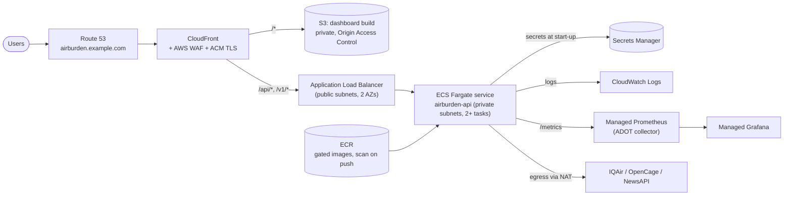
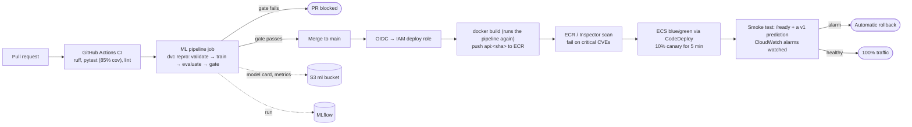
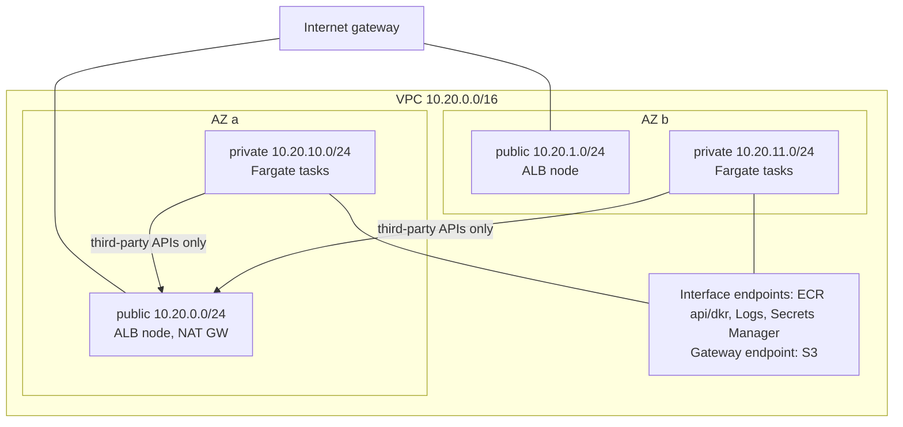

# AWS reference architecture

How AirBurden would run on AWS as a production service: the target architecture, the reasoning behind each choice,
and what it costs. It is a design, not a deployed system. The app runs on Render today, with a
[Cloud Run guide](deploy-gcp.md) for the API. Every component here maps onto code that already exists in this
repository.

**Region:** `ap-southeast-2` (Sydney). It is closest to the expected users, and the data is public, so there is
no residency constraint.

---

## 1. Requirements

| Type | Requirement | Target |
|---|---|---|
| Functional | Serve the dashboard (static SPA) and the model API (`/v1/...`) | |
| Functional | Retrain and release a model only when data contracts and release gates pass | |
| Functional | Proxy live air-quality and news lookups using third-party API keys | |
| Availability | API and dashboard | 99.9% monthly |
| Latency | Single prediction, p95, measured at the load balancer | < 300 ms |
| Recovery | Stateless service; artifacts reproducible from git + dataset | RTO 1 h, RPO 0 for code and models |
| Security | No long-lived credentials; secrets never in images; least-privilege IAM | |
| Traceability | Every prediction traceable to a model version, git commit and dataset hash | already in `/v1/model` |
| Cost | Lean profile under $10/month at portfolio traffic; production profile under $250/month | see §8 |

## 2. Architecture overview



| Current component | AWS service | Notes |
|---|---|---|
| React dashboard (`frontend/`) | **S3 + CloudFront** | Private bucket behind Origin Access Control; SPA fallback via a CloudFront error response to `/index.html`; hashed assets cached for a year |
| FastAPI service (`backend/app`) | **ECS on Fargate** behind an **ALB** | Same Docker image as today; ALB health check on `/ready` |
| Model bundle (baked into the image) | **ECR** | The image *is* the release unit: tagged by commit, scanned on push, immutable tags |
| Pipeline artifacts, DVC remote | **S3** (versioned) | `s3://airburden-ml/dvc` for the DVC cache, `.../reports` for model cards and metrics |
| Experiment tracking (MLflow) | **MLflow on a small Fargate task**, S3 artifact store | SQLite on the task's EFS volume is enough for one team. SageMaker managed MLflow is the hands-off option, but it bills per tracking-server hour (hundreds of dollars a month), so only with a team-sized budget |
| API keys (`.env`) | **Secrets Manager** | Injected into the task definition as `secrets`, never baked into the image |
| JSON logs with request IDs | **CloudWatch Logs** | Logs Insights queries by `request_id`, `route`, `status` |
| Prometheus `/metrics` | **Amazon Managed Service for Prometheus** + **Managed Grafana** | Scraped by an ADOT collector sidecar |
| Drift check (`ml/drift.py`) | **EventBridge Scheduler → ECS task** | Weekly run on sampled request logs; alerts through **SNS** |
| CI/CD (GitHub Actions) | GitHub Actions with **OIDC → IAM role** | No AWS access keys stored in GitHub |

## 3. Request flow

1. The browser resolves `airburden.example.com` (Route 53 alias) to CloudFront. TLS terminates with an ACM certificate.
2. AWS WAF evaluates the request: AWS managed rule groups (common, known bad inputs, IP reputation) and a
   rate-based rule. The rate limit is tighter on `POST /v1/predictions/batch`, the most expensive route.
3. Static paths are served from S3 through the CloudFront cache. `/v1/*` and `/api/*` are forwarded, uncached, to the ALB.
4. The ALB only accepts traffic carrying a secret custom header set by CloudFront, so the ALB cannot be reached
   around WAF. It forwards the request to a healthy Fargate task in either AZ.
5. The task validates the input with Pydantic, predicts, and returns the result with `X-Model-Version` and `X-Request-ID`.

## 4. ML lifecycle and delivery pipeline



* **The model ships inside the image.** The same image that passed the gates in CI is what runs. This avoids a
  separate model-sync step and any skew between code and model (see ADR-2).
* **Two gates:** release criteria in the pipeline (held-out-country and temporal R², accuracy) and operational
  checks in the deployment (5xx rate, p95 latency, `/ready`). Either one stops a release.
* **Frontend deploys** run `npm run build`, `aws s3 sync --delete`, then a CloudFront invalidation of `/index.html`.
  Hashed assets need no invalidation.

## 5. Network design



* Tasks run in **private subnets** with no public IPs. Their security group accepts traffic only from the ALB's
  security group, on port 8000.
* **VPC endpoints** carry ECR image pulls, logs, secrets and S3 traffic, so the NAT gateway only handles the
  three third-party APIs. This saves data-processing charges and narrows egress.
* **One NAT gateway** (in AZ a) is a deliberate cost trade-off. If AZ a fails, only the live air-quality and news
  panels degrade, and they already return a clean 503. The models keep serving. Production-critical egress
  would use one NAT per AZ.

## 6. Security

| Layer | Control |
|---|---|
| Identity | GitHub Actions assumes a deploy role through **OIDC**, scoped to this repository's `main` branch. The ECS **task role** has no permissions (the app calls no AWS APIs). The **execution role** can only pull from this ECR repository and read these three secrets |
| Edge | **WAF** managed rules + rate limiting; **Shield Standard**; TLS 1.2+ only; HSTS and security headers via a CloudFront response-headers policy |
| Network | Private subnets, security groups referencing other security groups, an ALB reachable only from CloudFront (managed prefix list + header check) |
| Data | S3 Block Public Access, SSE-S3/KMS encryption, versioning; logs encrypted; no personal data is processed |
| Secrets | Secrets Manager with rotation reminders; never in images, the repo or build logs |
| Supply chain | Locked dependencies, **CodeQL** and dependency review in CI, ECR immutable tags, Inspector scanning, non-root container user |
| Detection | **GuardDuty**, **Security Hub** (AWS Foundational Security Best Practices), **CloudTrail** to a separate log-archive account |
| Accounts | AWS Organizations with separate `dev`, `prod` and `log-archive` accounts; SCPs deny leaving the region and disabling CloudTrail |

## 7. Reliability, scaling and recovery

* **Multi-AZ:** the ALB and at least two Fargate tasks, spread across two AZs.
* **Health:** the ALB checks `/ready`, which returns 503 until a compatible model is loaded. A bad image never
  receives traffic. `/health` stays available as a liveness signal.
* **Deployments:** CodeDeploy blue/green with a canary and automatic rollback on CloudWatch alarms. The ECS
  deployment circuit breaker is a second line of defence.
* **Autoscaling:** target tracking on ALB requests per target (about 150) and CPU (60%), between 2 and 6 tasks.
  Inference is CPU-bound and stateless, so it scales horizontally.
* **Graceful degradation:** a third-party API outage maps to 502/503 for its panel only (already implemented).
* **Disaster recovery:** the service is stateless. To recover from a region loss, apply the infrastructure code
  in another region, then push the last image (ECR cross-region replication) and the dashboard build. The data and
  models are reproducible from git and the pinned dataset hash. RTO is about 1 hour; RPO is zero for code and models.

## 8. Cost

Rough monthly figures for `ap-southeast-2`, assuming low traffic (under 1 M requests a month). They are an
order of magnitude only; check them in the [AWS Pricing Calculator](https://calculator.aws/).

**Production profile (this design)**

| Item | Assumption | ≈ USD / month |
|---|---|---|
| ECS Fargate | 2 tasks × 0.5 vCPU / 1 GB, always on | 40-45 |
| Application Load Balancer | 1 ALB, low LCU usage | 20-25 |
| NAT gateway | 1 gateway, little data | 40-50 |
| VPC interface endpoints | 4 endpoints × 2 AZs | 55-80 |
| WAF | 1 web ACL, about 5 rules | 10-12 |
| CloudFront + S3 + Route 53 | low traffic | 2-5 |
| CloudWatch, Managed Prometheus, Secrets Manager | modest volumes | 10-15 |
| **Total** | | **≈ 175-235** |

Interface endpoints and the NAT gateway dominate. At this scale, dropping the interface endpoints and sending
that traffic through the single NAT gateway saves about $55-80, bringing the total to about $120-155. That is the
right call until image pulls and log volume grow.

**Lean profile (portfolio traffic)**

| Item | Assumption | ≈ USD / month |
|---|---|---|
| Lambda (container image) + Lambda Web Adapter | about 10k requests, 1 GB, about 300 ms each; cold start 3-6 s | < 1 |
| API Gateway HTTP API | about 10k requests | < 1 |
| CloudFront + S3 + Route 53 | | 1-2 |
| Secrets Manager (3 secrets) | | about 1.2 |
| **Total** | | **≈ 3-5** |

The same image runs on Lambda unchanged: the [Lambda Web Adapter](https://github.com/awslabs/aws-lambda-web-adapter)
runs uvicorn behind a Lambda extension. No VPC, NAT or load balancer is needed. The trade-offs are cold starts and
no persistent `/metrics` scraping (use CloudWatch metrics and Embedded Metric Format instead).

## 9. Well-Architected review

| Pillar | How the design addresses it |
|---|---|
| Operational excellence | Infrastructure as code; deploys only from CI; structured logs with request IDs; dashboards and runbooks per alarm; model cards per release |
| Security | OIDC instead of keys, least-privilege roles, private subnets, WAF, secrets in Secrets Manager, scanned and immutable images, GuardDuty and Security Hub |
| Reliability | Multi-AZ, `/ready`-gated traffic, canary with automatic rollback, autoscaling, stateless and reproducible artifacts |
| Performance efficiency | CPU-sized Fargate tasks, CloudFront caching of hashed assets, a lazy-loaded SPA, vectorised batch endpoint |
| Cost optimisation | Lean (Lambda) and production (Fargate) profiles, one NAT, Fargate Spot for the drift job, S3 lifecycle rules for old reports |
| Sustainability | Scale-to-zero option, right-sized tasks, Graviton (ARM64) images as a follow-up (scikit-learn ships ARM wheels) |

## 10. Architecture decisions

**ADR-1: ECS Fargate for the API (not EKS, Lambda or SageMaker endpoints)**
* *EKS:* the control-plane cost and operational load are not justified for one service.
* *Lambda:* the cheapest option at low traffic (the lean profile), but cold starts of several seconds with
  pandas and scikit-learn, and no long-lived `/metrics` endpoint.
* *SageMaker real-time endpoints:* built for heavier models and managed inference containers. Here they add cost
  and a second serving stack for a 20 MB scikit-learn model that FastAPI serves in milliseconds.
* *Decision:* Fargate for production (steady latency, standard ALB health checks, Prometheus scraping), with
  Lambda as the documented low-cost profile.

**ADR-2: bake the model into the image instead of loading it from S3 at start-up**
* *Pros:* one immutable, scanned release unit; what passed the gates is exactly what runs; no runtime S3 dependency.
* *Cons:* a model change means a new image. At 20 MB and roughly a minute of build time, that is acceptable.
* *Revisit when* models are retrained much more often than the code changes, or grow past a few hundred MB. Then
  use the SageMaker Model Registry or an S3 registry with a promotion step.

**ADR-3: CloudFront in front of both the SPA and the API**
* A single origin for the browser means no CORS in production, one WAF and one TLS certificate, and edge caching
  for static assets.

**ADR-4: one NAT gateway instead of one per AZ**
* Egress only serves non-critical live panels that already degrade gracefully. This saves about $35-45 a month.

**ADR-5: GitHub Actions instead of CodePipeline**
* CI, the ML gates and the security scans already run in GitHub Actions. With OIDC there are no stored keys, so a
  second CI system adds nothing.

## 11. Infrastructure as code

Terraform, one root module per environment and account:

```
infra/
  modules/
    network/        VPC, subnets, NAT, endpoints
    edge/           CloudFront, WAF, ACM, Route 53, S3 site bucket (OAC)
    service/        ECR, ECS cluster/service/task, ALB, autoscaling, CodeDeploy, alarms
    observability/  log groups, AMP workspace, Grafana, SNS topics, dashboards
    ml/             S3 ML bucket (versioned), MLflow, EventBridge drift schedule
    ci/             GitHub OIDC provider and the deploy role
  envs/
    dev/  prod/     backend: S3 state with DynamoDB locking (in a separate account)
```

`terraform plan` runs on every pull request that touches `infra/`, and `apply` runs only from `main` through the
OIDC role. Drift between the code and real infrastructure is checked nightly.

## 12. Rollout plan

1. **Foundation:** accounts, OIDC role, state backend, network module.
2. **Edge + SPA:** S3 + CloudFront + WAF serving the dashboard against the existing API.
3. **API:** ECR + ECS service behind the ALB; shift the `/v1` path in CloudFront; compare latency and error rates.
4. **Delivery:** blue/green deployments, alarms and automatic rollback; retire the old host.
5. **ML ops:** DVC remote on S3, MLflow, scheduled drift checks with SNS alerts.

## 13. Risks

| Risk | Mitigation |
|---|---|
| Free third-party API quotas exhausted by traffic | WAF rate limits; cache responses per city for 10 minutes; panels degrade to 503 |
| Model quality regresses on retraining | Release gates in CI and at image build; canary deployment |
| Cost creep (NAT, endpoints, logs) | AWS Budgets alerts; 30-day log retention; the lean profile when traffic is low |
| Container CVEs | Inspector scanning, Dependabot, regular base-image updates |
