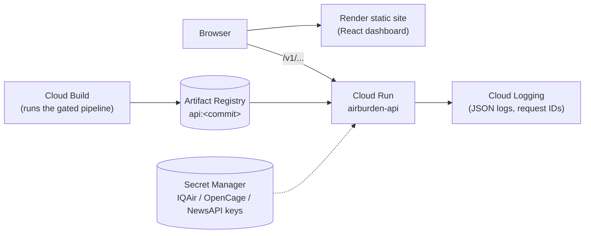

# Deploying the API to Google Cloud Run

Cloud Run runs the same Docker image as Render. It also scales to zero when idle, so it costs nothing at
portfolio traffic, but a cold start takes seconds instead of about a minute. The dashboard can stay on
Render: static sites there do not sleep, so only the API needs to move.



Region used below: `australia-southeast1` (Sydney). Use `australia-southeast2` for Melbourne; replace it everywhere.

## 0. One-time setup (about 10 minutes)

1. Create a project at <https://console.cloud.google.com> and attach a billing account. Billing is required even
   for the free tier.
2. **Set a budget alert first:** Billing → Budgets & alerts → Create budget → $5, with alerts at 50%, 90% and 100%.
3. Install the gcloud CLI (<https://cloud.google.com/sdk/docs/install>) or use **Cloud Shell** in the console,
   which already has it. Then:

```bash
gcloud auth login
```

```bash
gcloud config set project YOUR_PROJECT_ID
```

```bash
gcloud config set run/region australia-southeast1
```

```bash
gcloud services enable run.googleapis.com artifactregistry.googleapis.com cloudbuild.googleapis.com secretmanager.googleapis.com
```

```bash
gcloud artifacts repositories create airburden --repository-format=docker --location=australia-southeast1 --description="AirBurden images"
```

Create a dedicated identity for the service, with no permissions by default (least privilege):

```bash
gcloud iam service-accounts create airburden-api --display-name="AirBurden API runtime"
```

## 1. Build the image with Cloud Build

From the repository root. `cloudbuild.yaml` builds `backend/Dockerfile`, which runs the full pipeline
(validate → train → evaluate → gate). **The build fails if the data breaks its contract or the model misses a
release gate**, so a bad model never reaches the registry.

```bash
gcloud builds submit --config cloudbuild.yaml --substitutions=_GIT_COMMIT=$(git rev-parse --short HEAD) .
```

It takes about 4-6 minutes. If it fails with a permission error on pushing the image, grant the build service
account access to the registry (shown in the error message) and run the build again:

```bash
gcloud projects add-iam-policy-binding YOUR_PROJECT_ID --member="serviceAccount:PROJECT_NUMBER-compute@developer.gserviceaccount.com" --role="roles/artifactregistry.writer"
```

## 2. Deploy to Cloud Run

```bash
gcloud run deploy airburden-api \
  --image=australia-southeast1-docker.pkg.dev/YOUR_PROJECT_ID/airburden/api:latest \
  --service-account=airburden-api@YOUR_PROJECT_ID.iam.gserviceaccount.com \
  --port=8000 \
  --cpu=1 --memory=1Gi \
  --min-instances=0 --max-instances=3 \
  --cpu-boost \
  --concurrency=40 \
  --timeout=30 \
  --allow-unauthenticated \
  --set-env-vars=CORS_ORIGINS=https://airburden.onrender.com,LOG_FORMAT=json \
  --startup-probe=httpGet.path=/ready,httpGet.port=8000,periodSeconds=2,timeoutSeconds=2,failureThreshold=30
```

| Flag | Why |
|---|---|
| `--port=8000` | the container listens on 8000 (Cloud Run's default is 8080) |
| `--min-instances=0` | scale to zero: free when idle. Set it to `1` to remove cold starts entirely (costs a few dollars a month) |
| `--max-instances=3` | caps cost if someone hammers the public API |
| `--cpu-boost` | extra CPU during start-up, so the model loads faster on a cold start |
| `--startup-probe` | traffic only arrives once `/ready` reports that a compatible model is loaded. If your gcloud version rejects this flag, drop it: the default TCP probe also works |
| `--allow-unauthenticated` | the API is public, like the Render one |

The command prints the service URL, e.g. `https://airburden-api-xxxxxxxx-ts.a.run.app`. Check it:

```bash
curl https://YOUR_SERVICE_URL/ready
```

```bash
curl -X POST https://YOUR_SERVICE_URL/v1/predictions/health-burden -H 'Content-Type: application/json' -d '{"year":1990,"exposure_mean_no2":123,"exposure_mean_ozone":566,"exposure_mean_pm25":642,"country":"Afghanistan","region_name":"Eastern Mediterranean Region"}'
```

You should get `"model_version":"2.1.0"` and a prediction of `15533.0`.

## 3. Optional: live air-quality and news keys (Secret Manager)

The keys never go into the image or the environment as plain text. Create one secret per key:

```bash
printf '%s' 'YOUR_IQAIR_KEY' | gcloud secrets create iqair-api-key --data-file=-
```

```bash
printf '%s' 'YOUR_OPENCAGE_KEY' | gcloud secrets create opencage-api-key --data-file=-
```

```bash
printf '%s' 'YOUR_NEWSAPI_KEY' | gcloud secrets create news-api-key --data-file=-
```

Let only the service's identity read them:

```bash
for s in iqair-api-key opencage-api-key news-api-key; do gcloud secrets add-iam-policy-binding $s --member="serviceAccount:airburden-api@YOUR_PROJECT_ID.iam.gserviceaccount.com" --role="roles/secretmanager.secretAccessor"; done
```

Mount them as environment variables:

```bash
gcloud run services update airburden-api --set-secrets=IQAIR_API_KEY=iqair-api-key:latest,OPENCAGE_API_KEY=opencage-api-key:latest,NEWS_API_KEY=news-api-key:latest
```

## 4. Point the dashboard at Cloud Run

1. Render → the **airburden** static site → Environment → set `VITE_BACKEND_URL` to the Cloud Run URL (no
   trailing slash).
2. **Manual Deploy → Clear build cache & deploy.** Vite bakes the URL in at build time, so a rebuild is needed.
3. If the dashboard has a custom domain, add it to `CORS_ORIGINS` (comma-separated) with
   `gcloud run services update airburden-api --update-env-vars=...`.
4. Once everything works, suspend or delete the `airburden-api` web service on Render, and update the API link
   in the README.

## 5. Shipping a new version

```bash
gcloud builds submit --config cloudbuild.yaml --substitutions=_GIT_COMMIT=$(git rev-parse --short HEAD) .
```

```bash
gcloud run deploy airburden-api --image=australia-southeast1-docker.pkg.dev/YOUR_PROJECT_ID/airburden/api:$(git rev-parse --short HEAD)
```

Every image is tagged with its commit, and `/v1/model` reports the same commit, so you can always tell what is
running. To roll back, deploy an older tag or use **Revisions → Manage traffic** in the console.

## 6. Observability

* **Logs:** Cloud Run → airburden-api → Logs. The API writes one JSON object per line with `severity` and
  `request_id`, so you can filter with `jsonPayload.request_id="..."` or `severity>=WARNING`.
* **Metrics:** the Metrics tab shows request count, latency percentiles, instance count and cold starts.
  The app's Prometheus metrics stay available at `/metrics`.

## Cost

At portfolio traffic this stays inside Cloud Run's free tier: the service only bills while it handles a request,
and it scales to zero in between. Artifact Registry charges a few cents a month once its storage passes the free
allowance. Delete old image tags now and then. The budget alert from step 0 covers anything unexpected.

## Later: deploy from GitHub Actions

To deploy on every merge to `main`, add a workflow that authenticates with
[Workload Identity Federation](https://github.com/google-github-actions/auth#preferred-direct-workload-identity-federation)
(no long-lived JSON keys), then runs the two commands from step 5. CI already gates the image, so the workflow
only needs to build and deploy.
