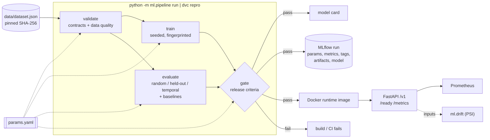

# MLOps: how a model gets from data to production

AirBurden 2.1 treats the model as a build artifact. It is produced by a deterministic, configuration-driven
pipeline. It is released only if it clears explicit quality gates. Every run is recorded, and the API
serving it can be observed. This page explains each piece and the reason for it.



## 1. Configuration: `backend/params.yaml`

`params.yaml` holds every number that affects a model: the data policy, the hyper-parameters, the evaluation
splits, the release thresholds and the tracking settings. `ml/config.py` loads it into typed pydantic models,
so a typo or an invalid value fails immediately instead of being ignored. Any value can be overridden without
editing the file:

```bash
python -m ml.pipeline run --set train.regressor.n_estimators=500 --set data.pollutant_repair=interpolate
```

A run is fully described by three things: the code commit, the params and the dataset hash. All three are
recorded in the model bundle and in MLflow.

## 2. Data validation: `ml/contracts.py`, `validate` stage

| Check | Type | On failure |
|---|---|---|
| Dataset SHA-256 equals `data.expected_sha256` | version pin | stop: the data changed upstream |
| **Raw contract**: column types, value ranges, ISO3 format, allowed WHO regions, DALY units, unique `(country, region, year)` | pandera schema | stop, report every violation |
| **Clean contract**: one row per country-year, one region per country, balanced panel, no nulls | pandera schema | stop |
| Share of suspicious isolated drops per column ≤ `data.max_suspicious_share` (currently about 7-8% in the pollutant columns, 0% in the target) | statistical expectation | stop |

Validation is lazy: a broken file produces the full list of problems, not just the first one. The stage writes
`artifacts/data/validated.parquet`, which is the only input to the later stages, and
`artifacts/reports/data_validation.json` with lineage (rows in and out, rows dropped, values repaired, hashes).

## 3. Reproducible training: `train` stage

* All randomness is seeded from `train.seed`.
* The bundle records the model version, a bundle-schema version, the git commit, the source and validated-data
  hashes, the full training params, and the scikit-learn and Python versions.
* **Prediction fingerprint**: a SHA-256 of every model's output on the training inputs. Identical code, data
  and params must give an identical fingerprint. `tests/test_reproducibility.py` enforces this. A local run and a
  Docker build on a different base image both produced `885cf7f9…`.
* The bundle also stores the training range of each feature (used by the API for extrapolation warnings) and
  a quantile profile of each feature (the reference distribution for drift checks).

## 4. Evaluation and release gates: `evaluate` and `gate` stages

Panel data makes a random split flattering (see [evaluation.md](evaluation.md)), so the gates are set on the
honest splits too:

| Gate (`params.yaml: gates`) | Threshold | Current |
|---|---|---|
| R² random split | ≥ 0.85 | 0.92 |
| R² held-out countries | ≥ 0.15 | 0.31 |
| R² held-out std across folds | ≤ 0.40 | 0.12 |
| R² temporal split | ≥ 0.60 | 0.74 |
| Risk accuracy, held-out countries | ≥ 0.45 | 0.60 |

The gate stage writes `reports/gate.json` and a [model card](model-card.md). It exits non-zero if any check fails.
Missing metrics also fail (the gate fails closed). Because the Docker build runs the same pipeline, **an image
cannot be built around a model that fails its gates**.

## 5. Experiment tracking: MLflow

The gate stage logs one MLflow run per pipeline execution:

* **params**: the flattened `params.yaml`
* **metrics**: headline evaluation metrics and data-quality shares
* **tags**: git commit, dataset hash, model version, fingerprint, gate result
* **artifacts**: reports, model card, metadata and, if the gates pass, the model bundle

The store is a local SQLite file (`backend/mlflow.db`; artifacts in `backend/mlruns/`, both git-ignored).
Point `tracking.uri` at a remote MLflow server to share runs. MLflow is optional: without it, or with
`--no-track`, tracking becomes a no-op. The Docker build works this way.

```bash
make pipeline ARGS="--set data.pollutant_repair=interpolate"     # a tracked experiment
pip install mlflow && make mlflow                                # compare runs at http://127.0.0.1:5000
```

The first experiment run this way is documented in [experiments.md](experiments.md).

## 6. Pipeline orchestration: DVC

`backend/dvc.yaml` declares the same four stages with their code, data and params dependencies. `dvc repro` re-runs
only what changed. For example, editing `gates` re-runs just the gate stage, while editing `data` re-runs everything.
`dvc.lock` records the hashes of every input and output of the last run.

```bash
pip install dvc
cd backend && dvc repro && dvc metrics show
dvc params diff main        # what changed in params.yaml compared with main
```

Every stage is a plain `python -m ml.pipeline <stage>` call, so DVC is a convenience and not a requirement.
To share the stage cache (validated data, model bundle) between machines, add a remote:
`dvc remote add -d storage s3://<bucket>/airburden`.

## 7. Serving: `backend/app`

| Concern | Implementation |
|---|---|
| Versioned API | `/v1/predictions/health-burden`, `/v1/predictions/risk-level`, `/v1/predictions/batch` (≤ 500 rows, vectorised), `/v1/clusters/assign`, `/v1/model`. The dashboard's original routes stay as deprecated aliases. |
| Input validation | Pydantic schemas. Unknown countries and region mismatches return 422; a bad row in a batch is reported by index. |
| Extrapolation warnings | Inputs outside the training range come back with a `warnings` list ("year 2035 is after the last training year…"). |
| Model compatibility | The bundle-schema version and required keys are checked at startup; an incompatible artifact is refused. |
| Probes | `/health` (liveness) and `/ready` (readiness: 503 until a compatible model is loaded; used by Docker and Render) |
| Traceability | Every response carries `X-Model-Version` and `X-Request-ID` (propagated from the caller or generated) |
| Logging | One JSON object per line, including the request ID, route, status and latency (`LOG_FORMAT=text` for local use) |
| Metrics | Prometheus `/metrics`: request count and latency by route template, predictions by model and outcome, predicted DALY-rate histogram (output drift), out-of-range inputs by feature, and `airburden_model_info` |
| Errors | A catch-all handler returns `{"detail", "request_id"}` and never a traceback |

```bash
curl -X POST localhost:8000/v1/predictions/batch -H 'Content-Type: application/json' -d '{"items": [
  {"year": 2015, "exposure_mean_no2": 400, "exposure_mean_ozone": 500, "exposure_mean_pm25": 600,
   "country": "Afghanistan", "region_name": "Eastern Mediterranean Region"}]}'
```

## 8. Monitoring for drift: `ml/drift.py`

```bash
python -m ml.drift --current new_rows.json      # exit code 1 if any feature drifted significantly
```

The script computes the Population Stability Index (PSI) for each feature against the quantile profile stored in
the bundle at training time. PSI below 0.10 is stable, 0.10-0.25 is a moderate shift and above 0.25 is a significant
shift. CI runs it as a self-check. In production it would run on a sample of logged requests, together with the
`airburden_out_of_range_inputs_total` and `airburden_predicted_daly_rate` metrics.

## 9. Testing and CI

77 backend tests (`make cov`, 94% line coverage, CI fails under 85%):

| Area | Tests |
|---|---|
| Config | typed loading, dotted overrides, invalid values rejected |
| Data contracts | real data passes; negative values, unknown regions, bad ISO codes, duplicates, nulls, a country in two regions and an unbalanced panel are all caught |
| Pipeline | full run end to end, lineage recorded, dataset-hash pin enforced, data-quality threshold enforced, corrupted source rejected, training refuses unvalidated data, gates fail closed, CLI exit codes |
| Reproducibility | same seed gives the same fingerprint, a different seed gives a different one, the saved bundle round-trips |
| Tracking | a complete MLflow run with params, metrics and tags |
| Serving | v1 and legacy parity, batch consistency and limits, extrapolation warnings, readiness, request IDs, Prometheus metrics, OpenAPI deprecation, incompatible bundle refused, plus the original v1-bug regression tests |
| Drift | PSI ≈ 0 on the reference and large on a shifted batch, so only shifted features are flagged |

GitHub Actions runs four jobs: **backend** (ruff, tests, coverage gate), **ml-pipeline** (`dvc repro`, drift
self-check, metrics and model card in the job summary, reports uploaded), **frontend** (build) and **docker**
(build the gated image, then smoke-test `/ready`, a v1 prediction and `/metrics`).
